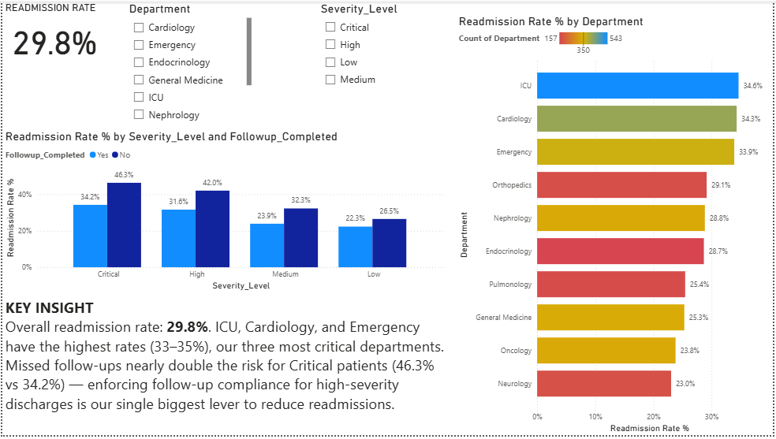
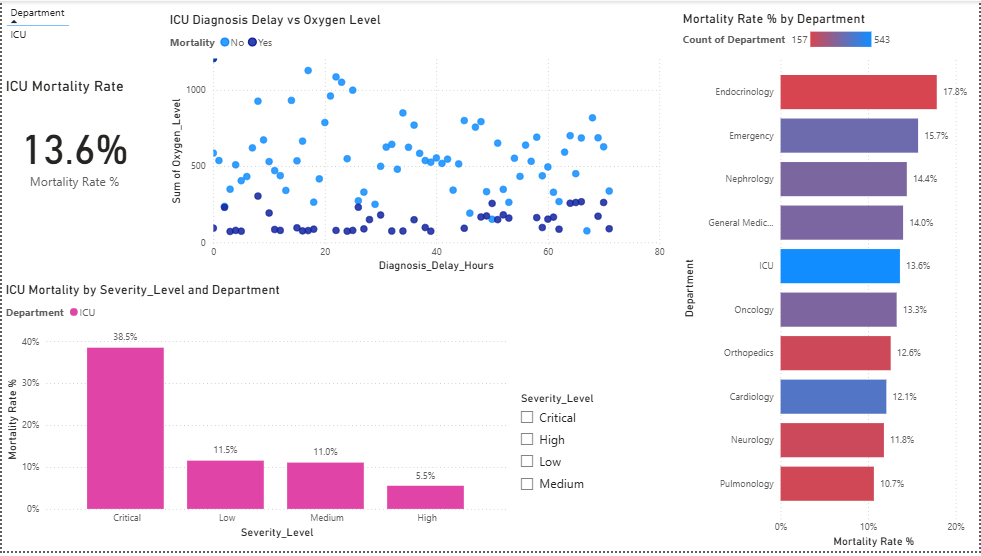
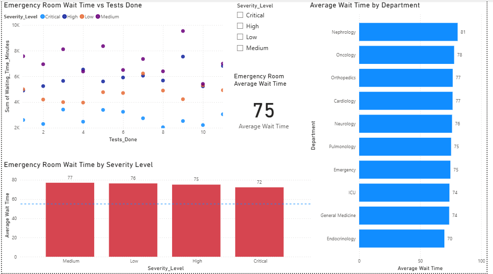
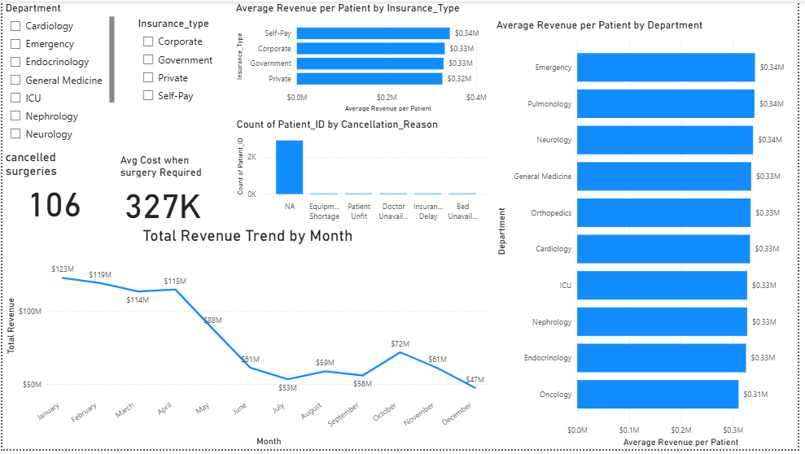
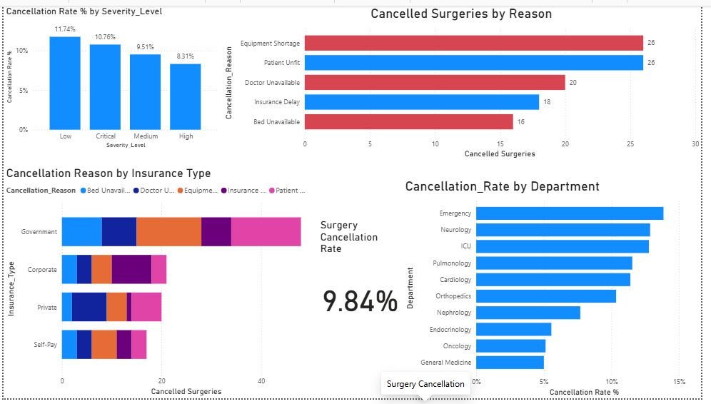
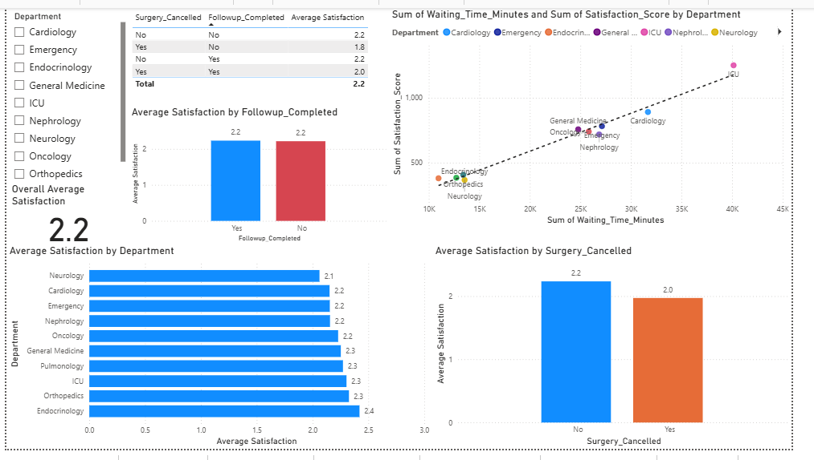
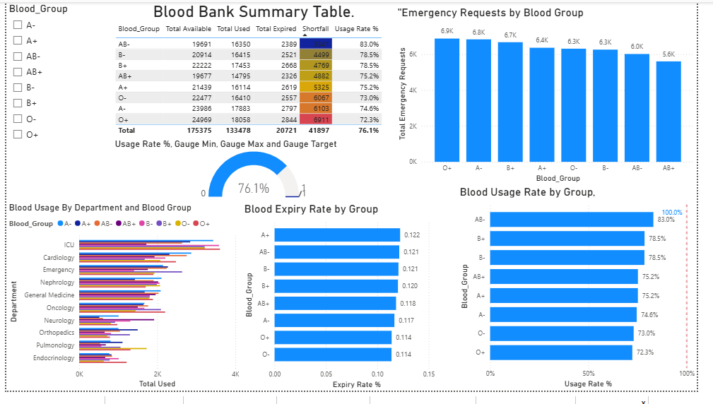
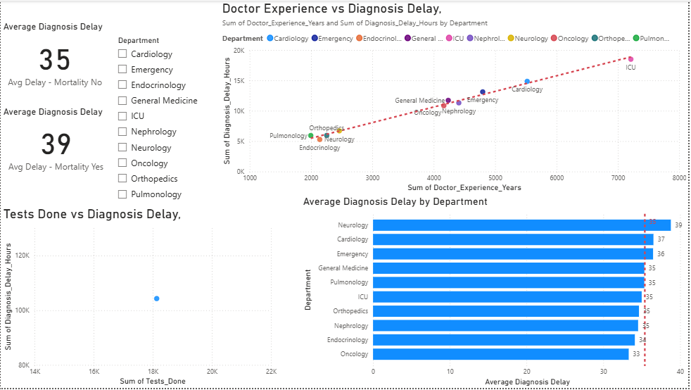
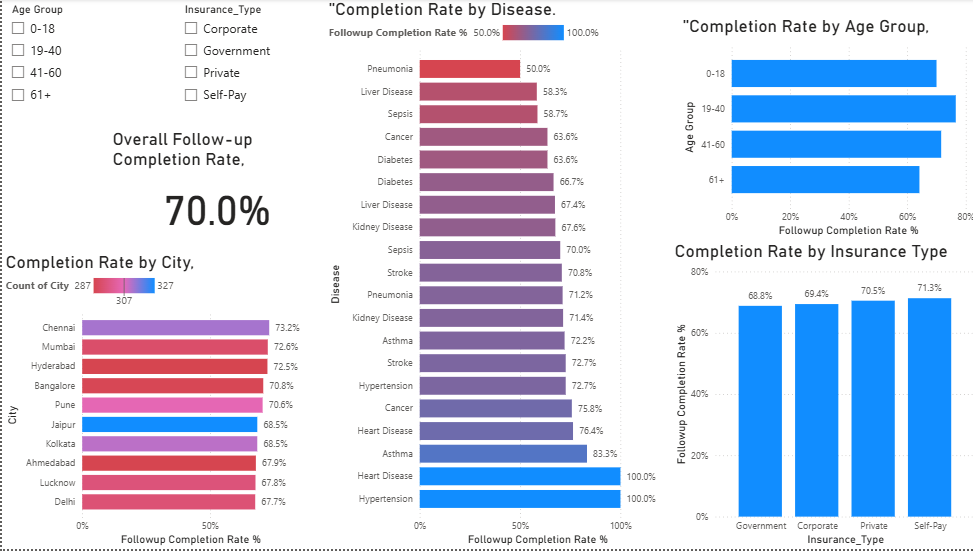

Hospital Data Analysis | Power BI Dashboard

An end-to-end Healthcare Data Analytics Project developed using Microsoft Power BI to analyze 3,000 patient records across 10 hospital departments from January 2025 to May 2026.

This project transforms hospital data into interactive dashboards to explore patient outcomes, operational efficiency, financial performance, emergency department delays, blood bank utilization, and patient satisfaction.

The dashboard consists of **9 analytical pages and 30 DAX measures**, providing insights into hospital performance and potential areas for operational improvement.

---

Project Overview

| Project Detail | Description |
|---|---|
| Project Name | Hospital Data Analysis |
| Domain | Healthcare Analytics |
| Dataset | Healthcare_Master |
| Total Records | 3,000 |
| Total Columns | 34 |
| Departments | 10 |
| Analysis Period | January 2025 – May 2026 |
| Dashboard Pages | 9 |
| DAX Measures | 30 |
| Visualization Tool | Microsoft Power BI |

Business Objectives

The primary objective is to analyze hospital operations and identify meaningful patterns that can support data-driven decision-making.

Key business questions:

1. Which departments have the highest patient readmission rates?
2. How does mortality vary across departments and severity levels?
3. What is the average emergency room waiting time?
4. How does treatment cost vary across departments and insurance types?
5. What are the major reasons for surgery cancellations?
6. How does waiting time relate to patient satisfaction?
7. How efficiently is hospital blood inventory utilized?
8. Is diagnosis delay associated with patient mortality?
9. What is the hospital's follow-up completion rate?

---

Tools & Technologies:

 Microsoft Power BI Desktop – Interactive dashboard development.
 Power Query– Data cleaning and transformation.
- DAX– Calculated measures and KPI development.
- Data Modelling – Organizing the analytical dataset.
- Data Visualization – Charts, tables, slicers and KPI cards.
- Data Analysis – Identifying trends, patterns and business insights.

---

 Dashboard Pages & Key Findings

1. Readmission Analysis



Key Findings:
- Overall readmission rate: 29.8%.
- ICU has the highest readmission rate at 34.6%.
- Cardiology: 34.3%.
- Emergency: 33.9%.
- Critical patients who missed follow-up had a 46.3% readmission rate compared with 34.2% among those who completed follow-up.

Business Insight: Follow-up compliance is associated with lower readmission rates, particularly among critical patients.

2. Mortality Analysis



Key Findings:
- Overall mortality rate: 13.6%.
- Endocrinology: 17.8%.
- Emergency: 15.7%.
- Nephrology: 14.4%.
- Pulmonology: 10.7%.

Business Insight: Mortality rates vary across departments and severity levels, highlighting areas for further clinical and operational investigation.

3. Emergency Delay Analysis:



Key Findings:
- Average emergency waiting time: 75.7 minutes.
- 63.5% of patients wait more than 55 minutes.
- Nephrology has the highest average waiting time at approximately 80.6 minutes.

Business Insight: Emergency waiting times represent an important operational metric for evaluating patient flow and service efficiency.

4. Revenue Analysis



Key Findings:
- Analyzed monthly hospital revenue trends.
- Compared average revenue per patient across departments.
- Evaluated revenue distribution by insurance type.
- Analyzed cancelled surgeries and associated treatment costs.

Business Insight:Department-wise and insurance-wise revenue analysis can help identify financial performance patterns.

 5. Surgery Cancellation Analysis



Key Findings:
- 1,077 surgeries were required.
- 106 surgeries were cancelled.
- Overall cancellation rate: 9.8%.
- Equipment shortage: 26 cancellations.
- Patient unfit: 26 cancellations.
- Doctor unavailable: 20 cancellations.

Business Insight:Equipment availability and patient readiness are important areas to investigate when reducing surgery cancellations.

 6. Patient Satisfaction Analysis



Key Findings:
- Average patient satisfaction: 2.23 out of 5.
- Waiting time and satisfaction have a negative correlation of approximately -0.56.
- Patients with cancelled surgeries reported an average satisfaction score of 1.97 compared with 2.23 for patients without cancelled surgeries.

**Business Insight:** Longer waiting times are associated with lower patient satisfaction, making waiting-time management an important improvement area.

7. Blood Bank Analysis



Key Findings:
- Total available blood units: 175,375.
- Total used blood units: 133,478.
- Blood usage rate: 76.1%.
- Expired blood units: 20,721.
- Blood expiry rate: 11.8%.

Business Insight: Blood inventory monitoring and expiry management can help reduce wastage and improve resource utilization.

 8. Diagnostic Error Analysis



Key Findings:
- Patients who died had an average diagnosis delay of 39.2 hours.
- Patients who survived had an average diagnosis delay of 34.8 hours.
- Analyzed diagnosis delay across hospital departments.
- Examined the relationship between doctor experience and diagnosis delay.

Business Insight: The observed difference in diagnosis delay highlights an area for further investigation. Association does not establish causation.

 9. Follow-up Compliance Analysis



Key Findings:
- Overall follow-up completion rate: 70%.
- Analyzed follow-up completion by disease.
- Compared compliance across age groups.
- Evaluated completion rates by city and insurance type.

Business Insight: Follow-up compliance analysis can help identify patient groups and departments that may benefit from improved follow-up processes.

---

 🧮 DAX Measures & KPIs

The project includes 30 DAX measures for calculating operational and clinical performance indicators.

Some important measures include:

 Patient Analysis

```DAX
Total Patients =
COUNTROWS(Healthcare_Master)

Total Readmitted =
CALCULATE(
    COUNTROWS(Healthcare_Master),
    Healthcare_Master[Readmitted] = "Yes"
)

Readmission Rate % =
DIVIDE(
    [Total Readmitted],
    [Total Patients],
    0
)
```

 Mortality Analysis

```DAX
Total Mortality =
CALCULATE(
    COUNTROWS(Healthcare_Master),
    Healthcare_Master[Mortality] = "Yes"
)

Mortality Rate % =
DIVIDE(
    [Total Mortality],
    [Total Patients],
    0
)
```

 Emergency Waiting Time

```DAX
Average Wait Time =
AVERAGE(
    Healthcare_Master[Waiting_Time_Minutes]
)

Long Wait Patients =
CALCULATE(
    COUNTROWS(Healthcare_Master),
    Healthcare_Master[Waiting_Time_Minutes] > 55
)

Long Wait Rate % =
DIVIDE(
    [Long Wait Patients],
    [Total Patients],
    0
)
```

 Surgery Cancellation

```DAX
Surgeries Required =
CALCULATE(
    COUNTROWS(Healthcare_Master),
    Healthcare_Master[Surgery_Required] = "Yes"
)

Cancelled Surgeries =
CALCULATE(
    COUNTROWS(Healthcare_Master),
    Healthcare_Master[Surgery_Cancelled] = "Yes"
)

Cancellation Rate % =
DIVIDE(
    [Cancelled Surgeries],
    [Surgeries Required],
    0
)
```

 Patient Satisfaction

```DAX
Average Satisfaction =
AVERAGE(
    Healthcare_Master[Satisfaction_Score]
)
```

 Diagnosis Delay

```DAX
Average Diagnosis Delay =
AVERAGE(
    Healthcare_Master[Diagnosis_Delay_Hours]
)

Avg Delay - Mortality Yes =
CALCULATE(
    [Average Diagnosis Delay],
    Healthcare_Master[Mortality] = "Yes"
)

Avg Delay - Mortality No =
CALCULATE(
    [Average Diagnosis Delay],
    Healthcare_Master[Mortality] = "No"
)
```

*Additional measures for blood inventory, follow-up compliance, revenue and other KPIs are included in the Power BI file.*

---

 Dataset & Data Quality

The analytical dataset contains 3,000 records and 34 columns.

Key data categories:

| Category | Important Columns |
|---|---|
| Patient Information | Patient_ID, Age, Gender, City |
| Admission | Department, Admission_Date, Discharge_Date, Stay_Days |
| Clinical | Oxygen_Level, Blood_Pressure, Heart_Rate |
| Doctor | Doctor_ID, Doctor_Experience_Years |
| Operations | Waiting_Time_Minutes, Insurance_Type, Treatment_Cost |
| Surgery | Surgery_Required, Surgery_Cancelled, Cancellation_Reason |
| Blood Bank | Blood_Group, Blood_Units_Available, Blood_Units_Used, Blood_Units_Expired |
| Patient Outcomes | Followup_Completed, Readmitted, Mortality |

Data quality observations:

- Doctor_ID: 45 missing values.
- Diagnosis_Delay_Hours: 50 missing values.
- Treatment_Cost: 70 missing values.

Missing values should be considered when interpreting measures involving these fields. No imputation method is claimed in this documentation.

Dataset source: Add the actual dataset origin here. Clearly identify whether it is a simulated, practice or real anonymized dataset before publication.

---

 Business Recommendations:

Based on the analysis:

1. Monitor readmission rates across high-readmission departments.
2. Improve follow-up tracking, particularly for high-severity patients.
3. Investigate long emergency waiting times and patient flow.
4. Review equipment availability and surgery cancellation patterns.
5. Improve blood inventory management to reduce expiry.
6. Monitor patient satisfaction and waiting-time trends.
7. Investigate diagnosis delays in departments with higher observed mortality rates.

These are analytical recommendations based on observed patterns, not proof of causal relationships or clinical conclusions.*

---

GitHub Repository Structure:


Hospital-Data-analysis-Powerbi/
README.md
hospital data analysis.pbi
hospital data analysis.pdf
screenshots/
    01_readmission.png
    02_mortality.png
    03_emergency_delay.png
    04_revenue.png
    05_surgery_cancellation.png
    06_patient_satisfaction.png
    07_blood_bank.png
    08_diagnostic_error.png
   09_followup_compliance.png


 How to Explore the Project

1. Download the Power BI `.pbix` file from this repository.
2. Open it using Microsoft Power BI Desktop.
3. Explore all nine dashboard pages.
4. Interact with the available department, severity, age group, insurance and blood group filters.
5. Review the PDF report for a static version of the dashboard.


 Skills Demonstrated

- Data Analysis
- Data Cleaning
- Data Transformation
- Data Modelling
- DAX Calculations
- KPI Development
- Business Intelligence
- Interactive Dashboard Development
- Analytical Thinking
- Data-driven Decision Making


Author:

Purna Chandra Sekhar Patibandla

Aspiring Data Analyst | Power BI | SQL | Excel | Python

LinkedIn: https://www.linkedin.com/in/purna-chandra-sekhar-patibandla

GitHub: https://github.com/chandupatibandla39
Email: chandupatibandla39@gmail.com


If you find this project interesting, feel free to explore the dashboards and share your feedback.

Thank you for visiting my Hospital Data Analysis project!
